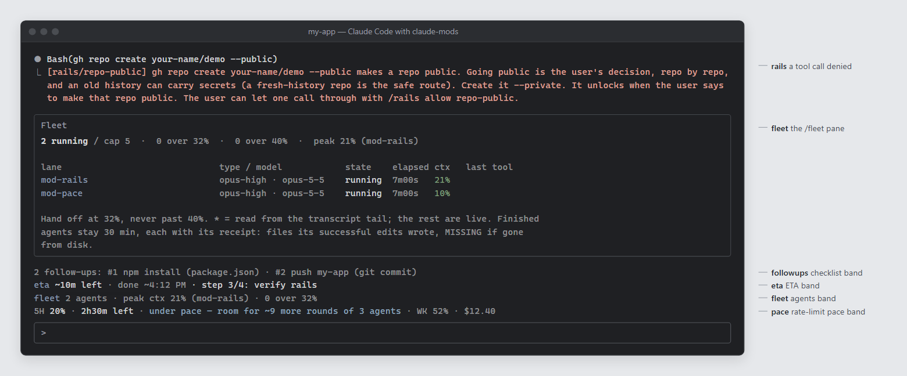

# claude-mods

Five Claude Code mods that add guardrails, follow-up checklists, live ETAs, subagent visibility and rate-limit pacing to every session.



*What each mod shows: a `rails` deny, the `/fleet` pane, and the `followups`, `eta`, `fleet` and `pace` bands above the prompt. This is a composite. Each text is the real output of that mod's code, run through Claude Code's mod test kit (`claude plugin test`) with demo inputs. The terminal window around them is drawn for the picture.*

## The mods

| Mod | What you see | What it does |
|---|---|---|
| `rails` | A tool call denied with `[rails/<rule>] why, and what to do instead`; `/rails` lists the rules | Turns "never do X" rules into `tool.call` denies. Some rules unlock for a while when you say so in your own prompt ("go", "confirm"); `/rails allow <rule>` lets exactly one blocked call through, `/rails off <rule>` switches a rule off for the session. |
| `followups` | A checklist band above the prompt; `/followups` | "After X, always do Y" rules. A successful edit or command opens an item; the matching later command closes it, or the model closes it with the `Followups` tool and evidence. One nudge per open item at the end of a turn. |
| `eta` | A live "about N min left" band above the prompt; `/eta` | The model declares an estimate through the `Eta` tool; the band counts down, learns how long subagents usually take, and calibrates declared against actual times. `/eta` shows every session on the machine. |
| `fleet` | A band and a `/fleet` pane | This session's subagents: lane, model, elapsed time, context % against a hand-off line and a ceiling, a cap on how many run at once, and receipts of the files each one actually wrote (`FleetReceipts` tool). |
| `pace` | A band above the prompt | Whether the session is on pace to use the 5-hour rate-limit window by its end, and how big the next round of agents can be. |

## Requirements

- Claude Code with mods (plugin hooks modules). Built and tested against Claude Code 2.1.302.
- No npm dependencies. The mods import only the host modules `claude-code` and `claude-code/testing`, which Claude Code provides at load time.
- `git` on PATH (rails and followups read repository state). `pace` reads status-line records (see Configure).

## Install

```sh
git clone https://github.com/Owen-Silva/claude-mods ~/.claude/mods
cd ~/.claude/mods
cp rails/hooks/rules.example.ts rails/hooks/rules.local.ts
cp followups/hooks/rules.example.ts followups/hooks/rules.local.ts
cp user.example.json user.local.json
```

The first two `cp` lines give you your own editable rule files. `rails` and `followups` import their active rules from `hooks/rules.local.ts`; without it they fall back to the shipped example rules and say so in a toast at every session start and at the top of `/rails` and `/followups`. The third gives you the name setting (see Configure).

Then load the mod folders into every session by listing them in `CLAUDE_CODE_PLUGIN_DIRS`, in the `env` block of `~/.claude/settings.json` (separate paths with `;` on Windows and `:` elsewhere):

```json
{
  "env": {
    "CLAUDE_CODE_PLUGIN_DIRS": "~/.claude/mods/rails;~/.claude/mods/followups;~/.claude/mods/eta;~/.claude/mods/fleet;~/.claude/mods/pace"
  }
}
```

For one session only, use `claude --plugin-dir ~/.claude/mods/rails` (repeat the flag per mod). Check a mod with `claude plugin validate <mod folder>`.

## Configure

Everything personal lives in files named `*.local.*`, which `.gitignore` keeps out of the repo.

- **Your name:** `user.local.json`, beside the mod folders, holds `{ "name": "Alex" }`. The mods use it wherever they refer to you, in text the model reads and in text you see: a rails deny ends "Alex can let one call through with /rails allow <rule>", and the eta and pace prompt lines and the followups checklist name you the same way. Without the file, or with one that is not valid, they say "the user" instead. rails says why in a toast at session start and at the top of `/rails`. A bad name file never switches a rule off: the deny still happens, with the default name.

- **Your rails rules:** edit `rails/hooks/rules.local.ts`. Each rule is one entry: an id, the tools it reads, a `check` that returns what matched, an optional prompt `unlock`, and the deny text. `rails/hooks/rules.ts` exports the shell parser and the building blocks (prompt approval, kill-by-name, scheduled-task and push-target checks, recursive-delete detection).
- **Your follow-up rules:** edit `followups/hooks/rules.local.ts`. A rule has an `open` (from a successful call) and a `progress` (what a later call showed toward closing the item).
- **eta** keeps per-session snapshots and a finished-task history in `~/.claude/mods-data/eta/` (derived from your home folder).
- **pace** reads Claude Code status-line records from `~/mission-control/data/statusline/` by default; set `PACE_STATUSLINE_DIR` to point it elsewhere. Without records it says so in the band instead of guessing.
- **pace promo (optional):** a one-time "reset for free" reminder is read from `pace/free-reset.local.json`. Without that file pace shows nothing about it.

## Tests

```sh
claude plugin test rails
claude plugin test followups
claude plugin test eta
claude plugin test fleet
claude plugin test pace
```

Each runs the mod's `*.test.ts(x)` files against the engine's test kit. Judge a run by its summary line (`N pass`, `0 fail`). Your own `*.local.test.ts` files run alongside the shipped ones and stay out of git.

## How it works, and why it's built this way

- **Hooks, not prompts.** A rule written in a memory file is a request the model can forget under load. `rails` sits on `tool.call`, so a forbidden call is refused before it runs, whatever the model believed. The deny text says why and what to do instead, so the model's next call is usually the right one.
- **Parse, don't grep.** Shell commands go through a small Bash/PowerShell lexer (`hooks/shell.ts`) that splits pipelines, strips quotes and finds the real program name. It also reads nested `bash -c`, `powershell -Command` and `cmd /c` commands. Rules match `git push` as a parsed command, not the substring "push", so quoting a command in a commit message does not trip a rule, and a path prefix, an `.exe` suffix or a nested shell does not dodge one.
- **Escape hatches are typed by the person.** A rule unlocks only from your own latest prompt (composer, phone bridge, SDK host), never from the model, a notification or another plugin. `/rails allow <rule>` lets one call through. A rule whose check throws lets the call through with a toast: a broken check must not block work, and it must not be silent.
- **Facts on disk over guesses.** `followups` opens an item only when the obligation is actually unmet (the search index is stale, a model is missing from a list, a repo is ahead of its remote) and closes it only when it is met, so a stray edit does not leave noise on the checklist.
- **Engine and rules are separate.** The shipped code is the engine plus example rules; your own rules live in an untracked `rules.local.ts`. One codebase serves everyone, and personal paths and project names never reach the repo. The engine loads only static imports, so `import ... from './rules.local'` resolves to your `rules.local.ts` when it exists and otherwise to the tracked `rules.local/index.ts`, which re-exports the examples and flags itself. A guard mod must never switch itself off quietly: a missing rules file degrades to the examples, loudly, instead of failing to load.
- **Calibrated, honest ETAs.** `eta` blends the model's declared estimate with measured subagent durations and backtested calibration of declared against actual times, and it never shrinks an estimate by more than a quarter, because a short number that later jumps is worse than a slightly long one.
- **No dependencies.** Every mod is plain TypeScript against the host API, with its state contract in `types/index.d.ts`, so there is nothing to install or audit beyond this repo.

## Licence

MIT. See [LICENSE](LICENSE).

Issues welcome; pull requests are not accepted right now.
